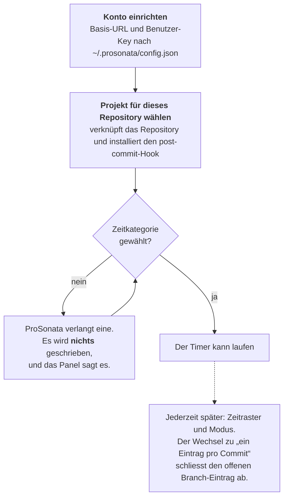
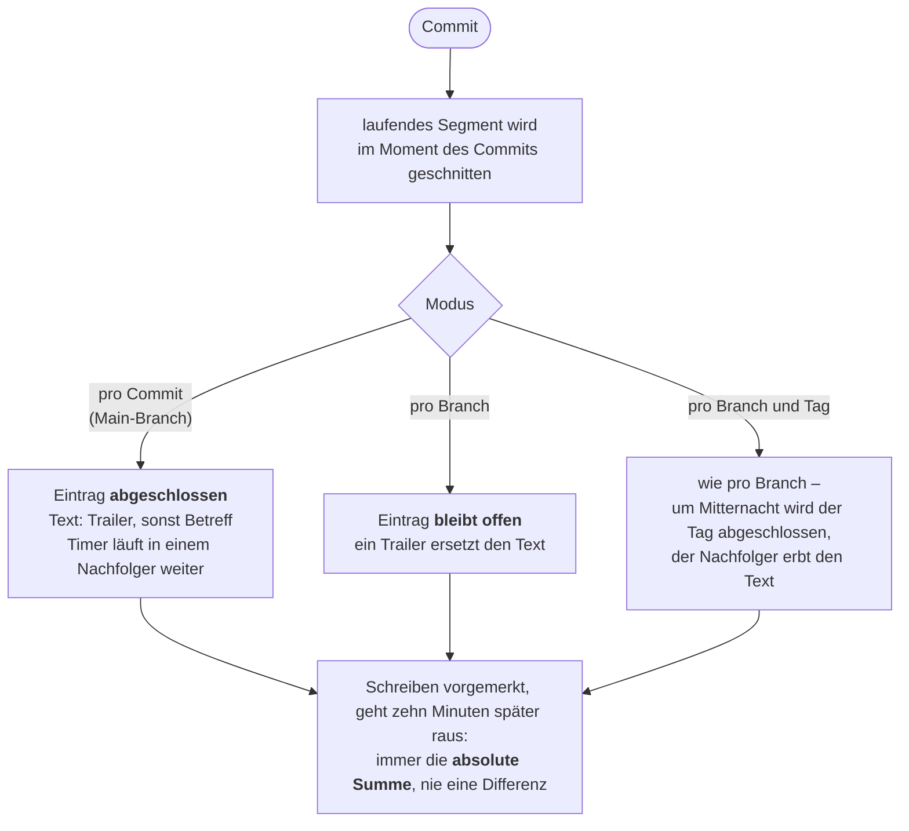
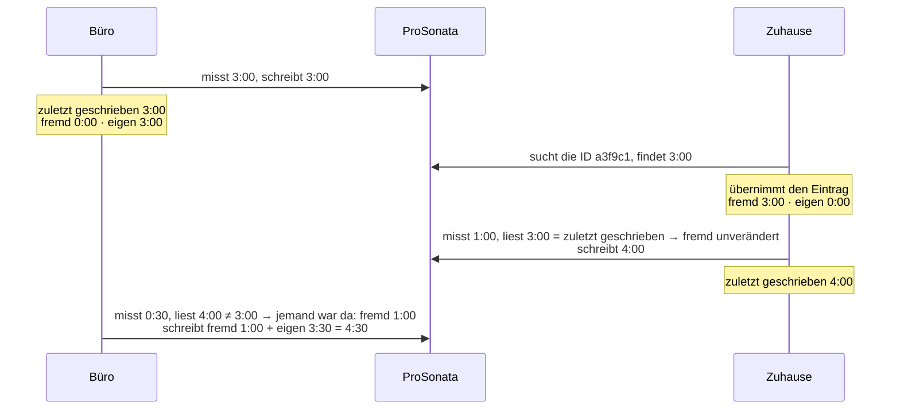
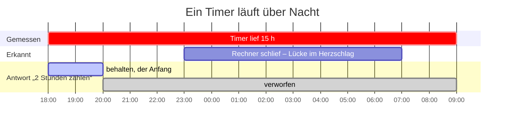

ProSonata Tools für Visual Studio Code
===========

[English](README.md) | Deutsch

Diese VS-Code-Extension legt [ProSonata](https://www.prosonata.de)-Zeiteinträge direkt aus VS Code an, gebunden an Commits und Branches, über die ProSonata-API. Statt in der Weboberfläche von ProSonata einen Timer zu starten und die Beschreibung von Hand zu tippen, startest du den Timer in VS Code, und die gemessene Zeit wird ein Zeiteintrag pro Branch – oder, umschaltbar, pro Branch und Tag oder pro Commit – mit einer Beschreibung aus dem Commit.

Die Idee: Ein Zeiteintrag steht für ein Stück Arbeit, das sich dem Kunden verrechnen lässt. Wer nach Leistung abrechnet, für den spielt es keine Rolle, ob die Arbeit einen Tag oder mehrere gedauert hat; wer nach Zeit abrechnet, für den sind die beiden anderen Modi da.

Dies ist kein offizielles Produkt von ProSonata.

## Sprache

Die Oberfläche ist englisch, mit deutscher Übersetzung. Die Extension folgt der Anzeigesprache von VS Code. CLI und Git-Hook nehmen die Sprache aus `LC_ALL`, `LC_MESSAGES` oder `LANG`, sonst aus der Sprache, die VS Code zuletzt verwendet hat.

Was nach ProSonata geht, bleibt deutsch: Ein offener Eintrag ist mit `[LAUFEND]` markiert, und ein Eintrag ohne Text heisst `(in Arbeit)`. Beides lässt sich in `~/.prosonata/config.json` ändern (`markerWord`, `placeholderText`).

## Installation

Suche in VS Code unter Erweiterungen nach **ProSonata Tools**, oder im Terminal:

```sh
code --install-extension profitlich.prosonata-vscode-tools
```

Die Extension steht im [Visual Studio Marketplace](https://marketplace.visualstudio.com/items?itemName=profitlich.prosonata-vscode-tools) und auf [Open VSX](https://open-vsx.org/extension/Profitlich/prosonata-vscode-tools) – dort finden sie auch Cursor, VSCodium und Windsurf. Updates kommen von selbst.

### Fertiges Paket

Ohne Zugang zum Marketplace: Lade das `.vsix` des neuesten
[Releases](https://github.com/profitlich-ch/prosonata-vscode-tools/releases)
herunter und installiere es über die Befehlspalette → *Extensions: Install from VSIX…*, oder:

```sh
code --install-extension prosonata-vscode-tools-<version>.vsix
```

So installiert, gibt es keine automatischen Updates.

### Aus dem Quellcode

Du brauchst eine Node-Umgebung. Bauen, Packen und Installieren geschehen in einem
Schritt – das Ergebnis ist dasselbe `.vsix` wie oben:

```sh
npm install
npm run install-vsix
```

Zum Aktualisieren nach `git pull` dasselbe noch einmal.

## Konfiguration

Öffne **ProSonata** in der Aktivitätsleiste und klicke auf ‹ProSonata: Konto einrichten›. Der Befehl fragt nach der Basis-URL von ProSonata und einem API-Key des Benutzers und schreibt beides mit Modus 0600 nach `~/.prosonata/config.json`.

**Nimm einen persönlichen Benutzer-Key, keine App-Integration**, damit die Zeiteinträge mit deinem Benutzer verknüpft sind.

Führe denselben Befehl später noch einmal aus, um **den Key oder die Basis-URL zu ändern** – etwa wenn der Key abläuft. Die Basis-URL ist schon ausgefüllt, und ein leeres Key-Feld behält den bisherigen. Alle anderen Einstellungen in `config.json` bleiben unberührt; das Zahnrad in der Titelleiste des Panels öffnet die Datei selbst. Dort stehen auch die Vorgaben, nach denen kein Dialog fragt: das Zeitraster, die Sendeverzögerung, die Warnschwellen und die Erkennung des Ruhezustands.

## Einstellungen pro Repository

Die Reihenfolge ist fest, und ein Schritt darin ist eine Sperre:



Klicke auf **ProSonata: Projekt für dieses Repository wählen** – das verknüpft das Repository mit einem Projekt und installiert den `post-commit`-Hook. Das Projekt zeigt danach sein Budget, etwa „15.25 von 20 h“. Geholt wird es beim Öffnen des Fensters und jedes Mal, wenn ein abgeschlossener Zeiteintrag ProSonata erreicht hat – nicht laufend.

Gleich danach fragt die Extension nach der **Zeitkategorie**. ProSonata verlangt eine auf jedem Zeiteintrag; solange keine gewählt ist, wird nichts geschrieben. Ändern lässt sie sich jederzeit über die Zeile *Kategorie* im Panel, und die Änderung gilt auch für die Einträge, die noch offen sind.

Auch das Projekt lässt sich später korrigieren. Weil eine Änderung fast immer einen Fehler behebt, ziehen alle unfertigen Zeiteinträge dieses Repositorys mit – auch die, die schon in ProSonata stehen, und die laufende Messung. Zurück bleibt nur, was abgeschlossen ist und dessen Abschluss ProSonata schon erreicht hat; ist ein solcher Eintrag dort schon fakturiert, entsteht im neuen Projekt ein Folgeeintrag statt einer Änderung.

Wählen lassen sich ausserdem das Zeitraster und der Modus: ein Eintrag pro Branch, pro Branch und Tag oder pro Commit (siehe [So funktioniert es](#so-funktioniert-es)). Das Zeitraster gilt für alle offenen Zeiteinträge, sobald sie das nächste Mal geschrieben werden. Der Wechsel zu „ein Eintrag pro Commit“ dagegen schliesst den offenen Branch-Eintrag ab und fragt vorher nach seinem endgültigen Text.

Das **Zeitraster gilt nur für den Zeiteintrag**, der nach ProSonata geht – nie für die Segmente. Messung und Log sind sekundengenau; gerundet wird erst beim Schreiben, und zwar einmal pro Zeiteintrag – nicht für jedes Segment. Gerundet wird **aufwärts** auf die nächste Stufe: Bei einem 15-Minuten-Raster werden gemessene 2:05 h als 2:15 h gebucht. Weil pro Eintrag gerundet wird, **wächst die Rundung mit der Zahl der Einträge**: Auf `main` mit drei Commits zu je zwanzig Minuten sind das drei halbe Stunden, also 1:30 h statt einer Stunde. Ein Branch-Eintrag, der dieselbe Arbeit sammelt, wird einmal gerundet. Überall wird dieser Wert als Stunden:Minuten angezeigt; ProSonata selbst zeigt ihn als Dezimalstunden (2.25), weil die API ihn so speichert.

Wählt ein Repository kein eigenes Raster, gilt die Vorgabe aus `~/.prosonata/config.json` (`"grid"`). Sie steht auf `exact` und lässt sich nur dort ändern – wer immer nach Viertelstunden abrechnet, stellt sie einmal ein statt in jedem Repository.

Jeder Befehl steht auch auf der [Kommandozeile](#cli-befehle) zur Verfügung.

## So funktioniert es

Während du in VS Code arbeitest, werden die Zeiten lokal auf deinem Rechner als
**Segmente** gespeichert. Ein **Zeiteintrag** ist das, was in ProSonata steht. Ein
Zeiteintrag besteht aus beliebig vielen Segmenten.

Das Schreiben nach ProSonata wartet nicht auf das Ende: Zehn Minuten nachdem der
Timer **startet**, legt das Werkzeug den Zeiteintrag an – noch ohne Text, unter
einem Platzhalter – und aktualisiert ihn danach bei jedem weiteren Schreiben mit
der gewachsenen Summe. Ein Branch-Eintrag steht also von Anfang an in ProSonata
und wächst dort. Das Abschliessen ist nur die letzte Aktualisierung.

| Wo du arbeitest | Was ProSonata bekommt | Gedacht für |
|---|---|---|
| Auf einem Branch | **Ein Eintrag pro Branch**, der über die ganze Lebensdauer des Branches wächst | Abrechnung nach Leistung: eine Zeile für das, was geliefert wurde |
| Auf einem Branch, umgeschaltet | **Ein Eintrag pro Branch und Tag** – um jede Mitternacht geschnitten | Abrechnung nach Zeit bei Branch-Arbeit: eine Zeile pro Tag mit Datum und Zeiten |
| Auf dem Main-Branch | **Ein Eintrag pro Commit** | Abrechnung nach Zeit: Wartung, jeder Commit eine Zeile |

Die Idee dahinter: Ein Branch ist das Stück Arbeit, das ein Kunde als Einheit bezahlt. Commits sind Zwischenschritte, die der Kunde nicht sehen muss. Arbeit auf dem Main-Branch dagegen ist Wartung, und jeder Commit ist einen eigenen Zeiteintrag wert. Der Modus lässt sich pro Branch umschalten („ProSonata: Modus für Zeiteinträge wählen“).

Was ein Commit bewirkt, hängt vom Modus ab – geschnitten wird das Segment in jedem Fall im Moment des Commits:



Der Text des Zeiteintrags kommt aus dem Commit, aus einem Trailer, der mit `Prosonata:` beginnt:

```txt
fix: Rundungsfehler in der zweiten Rabattstufe

Prosonata: Rabattberechnung im Shop korrigiert
```

Auf dem Main-Branch, wo jeder Commit seinen eigenen Eintrag abschliesst, gilt die
Betreffzeile, wenn es keinen Trailer gibt. Auf einem Branch zählt nur der Trailer;
der zuletzt in einem Commit geschriebene gewinnt, blosse Betreffzeilen werden
übergangen. Ein Eintrag ohne Text erscheint in ProSonata als
`[LAUFEND] (in Arbeit)` – der erste Trailer ersetzt den Platzhalter. Gebraucht
wird er, damit ein zweiter Rechner den Eintrag schon vor dem ersten Commit findet;
gesucht wird nach der ID, und die ID gibt es erst nach dem ersten Schreiben. Auf
einem Branch erinnert die Seitenleiste mit der Zeile **Ohne Text** daran, dass die
Rechnungszeile noch fehlt. Ein Eintrag ohne Text lässt sich nicht abschliessen: Er
landete für immer namenlos beim Kunden.

Was das Werkzeug über einen Zeiteintrag wissen muss, steht im Feld `apiComments`
von ProSonata, das auf keiner Rechnung erscheint: die ID des Branches, damit andere
Rechner den Eintrag wiederfinden, ob er offen ist, und seit wann ein Timer läuft.
Die Rechnungszeile trägt nur einen Hinweis für Menschen:

| Zustand | Text in ProSonata |
|---|---|
| offen | `[LAUFEND] Text` |
| abgeschlossen | `Text` |

Das `[LAUFEND]` fällt beim Fakturieren auf, sollte einmal ein Abschluss fehlen.
Es in ProSonata von Hand zu entfernen schadet nicht: Den Zustand trägt das Feld.
Einträge aus der Zeit vor dem Feld tragen die ID noch im Text, etwa
`[LAUFEND:a3f9c1] Text`; sie werden weiterhin erkannt und beim nächsten Schreiben
umgestellt.

Die Felder **Beginn** und **Ende** halten die Spanne des Arbeitstags – den Beginn
des ersten und das Ende des letzten Segments. Erstreckt sich ein Eintrag über
mehrere Tage, bleiben beide leer: Eine Spanne bedeutet nur für einen einzelnen Tag
etwas.

## Auf mehreren Rechnern

Die ID eines Branches entsteht aus dem ersten Commit des Repositorys und dem
Namen des Branches – in jedem Klon dieselbe. Der zweite Rechner findet den
Zeiteintrag deshalb wieder und **ergänzt** ihn, statt einen zweiten anzulegen.
Vorausgesetzt ist, dass die beiden nicht gleichzeitig messen.

Jeder Rechner merkt sich den **fremden Anteil** und schreibt `fremd + eigen`. Den
fremden Anteil kennt er aus der Differenz zwischen dem, was er zuletzt selbst
geschrieben hat, und dem, was in ProSonata steht.



Der geschriebene Wert hängt nur vom eigenen Zustand des Rechners ab, nie von dem,
was er gerade gelesen hat – ein wiederholtes Schreiben verdoppelt also nie etwas.

Zwei **Personen** dagegen kommen sich nicht in die Quere: Zeiten gehören in
ProSonata zu Benutzern, und jede hat ihren eigenen Eintrag pro Branch.

Läuft auf demselben Branch gerade auf einem anderen Rechner ein Timer, erfährst
du das beim Starten – mit dem Tag, an dem er gestartet wurde. War das vor
gestern, heisst es nicht mehr „läuft seit“, sondern „dort wurde vermutlich das Anhalten
vergessen“. Mehr als Bescheid geben kann die Extension nicht: Einen Timer auf
einem zugeklappten Laptop kann man von hier aus nicht anhalten.

Schliesst ein Rechner den Eintrag ab, während auf dem anderen Zeit angefallen ist,
fragt der andere: **zum abgeschlossenen Eintrag** dazu oder **einen neuen
anlegen**. Bis zur Antwort wird nichts geschrieben, und der abgeschlossene Eintrag
wird nie ungefragt angefasst.

## Wenn ein Timer vergessen wurde

Läuft ein Segment stundenlang, fragt die Extension, **wie viel davon zählt** –
alles, eine eigene Dauer oder nichts. Sie rät nicht: Ein Timer, der über Nacht
lief, hat Uhrzeit gemessen, und nur du weisst, wie viel davon Arbeit war.
Antwortest du „zwei Stunden“, sind das die **ersten** zwei – die Arbeit war am
Anfang, vergessen wurde das Anhalten.

Hat der Rechner zwischendurch **geschlafen**, weiss die Extension es genau: Timer
feuern nicht, während eine Maschine im Ruhezustand ist, und ein Herzschlag, der
Stunden später zurückkommt, beweist, dass auf diesem Rechner nichts lief. Das
Panel zeigt dann eine Zeile mit der gemessenen Dauer – abziehen oder behalten.
Nach dem Abziehen läuft der Timer ab dem Moment des Aufwachens weiter.



Ohne auf diese Frage zu warten, lässt sich ein laufendes Segment jederzeit
**ganz verwerfen** – der Fall „committet, Anhalten vergessen, danach nicht mehr
gearbeitet“. Die Option steht zuoberst im Korrekturdialog und nennt den Betrag.
Gebucht wird nichts, der Timer hält an, und das Log behält die verworfene Dauer
als `gekürzt von …`.

Die Zeit **vor- und zurückdrehen** lässt sich mit dem Stift-Symbol in der
Timer-Zeile oder mit „ProSonata: Zeit korrigieren“. Tippe entweder eine Dauer oder
eine Uhrzeit:

| Eingabe | Bedeutung |
|---|---|
| `25` | bietet `+25` und `−25` an |
| `-25`, `+1:30` | genau diese Richtung |
| `ab 9:40` | Ich arbeite seit 9:40 – der Beginn des laufenden Segments rückt dorthin |
| `bis 9:40` | Ich habe um 9:40 aufgehört – gebucht wird bis dahin, und der Timer hält an |

Die englischen `from 9:40` und `until 9:40` funktionieren ebenso.

**Uhrzeiten brauchen einen laufenden Timer.** Sie ändern das laufende Segment;
ist der Timer angehalten, gibt es keines, auf das sie sich beziehen könnten. Dann
füge Zeit als Dauer hinzu – `+20` bucht zwanzig Minuten, ohne zu behaupten, wann
sie angefallen sind. Das Log zeigt eine solche Korrektur deshalb ohne Startzeit.

Jede Option zeigt vorher, was sie tut: `7:13:09 → 7:08:09`. Keine Korrektur
reicht weiter zurück als bis zum **Ende des letzten Segments** – ein
abgeschlossenes Segment sagt genau, dass bis dahin alles richtig erfasst wurde.
Wird eine Korrektur deshalb gekürzt, sagt dieselbe Option, was stattdessen geht
und warum: „erst ab 14:25 → so weit reicht das letzte Segment“. Unter null fällt
ein Eintrag ebenfalls nie.

Das Schliessen des letzten VS-Code-Fensters pausiert den Timer. Abschalten lässt
sich das mit `"pauseOnWindowClose": false` in `~/.prosonata/config.json`.

Die Statusleiste zeigt, was der Branch **insgesamt** gesammelt hat – die Zahl,
die auf die Rechnung kommt. Das laufende Segment steht im Tooltip, zusammen mit
dem Branch und dem Stand des Sendens. Das Panel zeigt beide Zahlen nebeneinander,
das laufende Segment zuerst: `0:42:13 · 3:48:02`.

## Nacharbeit nach einem Commit

Auf `main` schliesst jeder Commit seinen Zeiteintrag ab. Arbeitest du danach
weiter – die letzte Prüfung, das Deployment, der Anruf – und committest nicht
noch einmal, hast du Zeit gemessen, die zum eben gemachten Commit gehört. Sonst
ginge sie erst mit dem **nächsten** Commit raus, unter dessen Text.

Dafür zeigt die Seitenleiste **Nicht gebucht**, sobald solche Zeit da ist. Sie
wird immer dem letzten abgeschlossenen Eintrag dieses Branches zugeschlagen, als
blosse Summe – Text und Datum dort bleiben, wie sie sind. Du bestätigst zuerst,
mit den Zahlen:

    5 Minuten zu „Kirby-Update, Linkfarbe Startseite“ (2026-08-02)
    aus 2:00 h werden 2:15 h

Die zweite Zeile ist der Grund für die Frage: Das Zeitraster rundet **aufwärts**,
ein Viertelstundenraster macht also aus fünf Minuten eine Viertelstunde. Ein
Eintrag, der schon **fakturiert** ist, wird abgelehnt – das geht nur in ProSonata
selbst. Steht der offene Eintrag schon in ProSonata, verschwindet er beim
Zuschlagen: Seine Zeit ist umgezogen. Nur wenn ein anderer Rechner in ihn gemessen
hat, bleibt er stehen, und das Zuschlagen wird abgelehnt.

## Unterbrochene Arbeit auf einen eigenen Branch nehmen

Du hast auf `main` etwas angefangen und musst es für etwas anderes unterbrechen.
Die Dateien ziehen mit `git switch -c thema` auf einen eigenen Branch um – die
Zeit nicht: Sie steckt im offenen Eintrag von `main`, und der nächste Commit dort
schlösse ihn unter dessen Text ab. (Der Squash-Merge eines Branches hält sie an
und fragt stattdessen, siehe [Einen Branch mergen](#einen-branch-mergen) – aber
bis dahin weiss vielleicht niemand mehr, wessen Zeit es war.)

Führe auf dem neuen Branch `prosonata take main` aus (oder „ProSonata: Offenen
Eintrag eines anderen Branches übernehmen“), und der offene Eintrag zieht mit
all seiner Zeit mit. `main` bleibt ohne offenen Eintrag zurück; der nächste Timer
dort beginnt einen frischen. Keine Sekunde ändert sich, nur wo die Zeit verrechnet
wird. Die Segmente bleiben im Log, wo sie gemessen wurden, und eine Zeile
**Übernommen von main** auf dem neuen Branch sagt, warum ihre Zeit dort
verrechnet wird.

Hat der neue Branch schon einen offenen Eintrag, wird nichts übernommen – leg die
beiden stattdessen beim Durchsehen der Zeiteinträge zusammen.

## Einen Branch mergen

Die Reihenfolge am Ende eines Pakets, nach einem Squash-Merge:

1. **Der Merge-Commit.** Er trägt den Trailer des Branches. Hat `main` in diesem
   Moment offene Zeit, wird sie **angehalten**, statt unter dem Text des Branches
   abgeschlossen zu werden – das ergäbe zwei Rechnungszeilen mit einem Text. Der
   Hook sagt es, und die Seitenleiste zeigt **Vor dem Merge von …**. Ein Klick
   darauf bietet drei Antworten: die Zeit dem Eintrag des gemergten Branches
   zuschlagen, sie mit eigenem Text abschliessen oder sie verwerfen. Im Terminal:
   `prosonata held`.
2. **Den Branch löschen.** Sein Eintrag erscheint in der Seitenleiste und in
   `prosonata status` als **Branch gelöscht**. `prosonata close <branch>`
   schliesst ihn mit dem Text ab, den er hat – dem letzten Trailer –, oder mit dem
   Text, den du nach dem Namen angibst.
3. **Prüfen, was rausging.** `prosonata sent` listet die aus diesem Repository
   gesendeten Einträge mit ihren ProSonata-Nummern. Ein falscher Text wird mit
   `prosonata sent <nr> text "…"` korrigiert, ein Eintrag ohne Zeit mit
   `prosonata sent <nr> drop` entfernt. Alles mit Zeit wird beim Durchsehen der
   Zeiteinträge korrigiert.

Ein Merge mit `--no-ff` erzeugt einen Merge-Commit, für den Git keinen Hook
aufruft, den dieses Werkzeug installiert; die offene Zeit auf `main` bleibt
einfach offen. Ein Amend oder ein Reset eines Commits auf `main` kurz nach dem
Committen braucht nichts: Bevor sein Eintrag rausgeht, zieht seine Zeit in den
Eintrag des Commits um, der ihn ersetzt hat.

## Zeiteinträge durchsehen

Das Listen-Symbol in der Titelleiste des ProSonata-Panels holt die Zeiteinträge
des aktuellen Repositorys aus ProSonata in eine Liste, in der sich mehrere
auswählen lassen; in der Befehlspalette heisst es „ProSonata: Zeiteinträge
durchsehen“. Es bietet drei Aktionen:

- **Text und Stunden ändern** – das Stift-Symbol in einer Zeile. Stunden tippst du
  als `h:mm` oder als Dezimalzahl; geschrieben wird die neue Summe, aufs Raster
  gerundet.
- **Zusammenlegen** – mehrere auswählen; ein Eintrag bleibt, die anderen werden
  gelöscht, sobald die Summe sicher auf dem verbleibenden steht. Die
  vorgeschlagenen Stunden kommen aus den gemessenen Segmenten, **einmal** aufs
  Raster gerundet: Wer nachträglich zusammenlegt, sagt, dass die Arbeit in einem
  Zug getan wurde, und ein Zug wird einmal gerundet, nicht dreimal. Decken die
  Segmente die Einträge nicht ab – weil etwa ein anderer Rechner gemessen hat –,
  wird die Summe aus ProSonata angezeigt, mit einem Hinweis, warum.
- **Löschen** – nach einer Bestätigung mit den Zahlen.

**Fakturierte Einträge bleiben stehen**, bei allen drei Aktionen: Sie gehören zur
Rechnung. Das Log der Segmente wird nicht angepasst; es bleibt das Archiv der
Messung, korrigiert wird die Abrechnung.

## Das Log

Das Uhr-Symbol daneben öffnet alle gemessenen Segmente als gerenderte Vorschau,
nach Tagen gruppiert, mit einer Auswahl des Branches davor. Bearbeiten lässt es
sich nicht: Das Log ist ein Archiv, und was verrechnet wird, steht im Zeiteintrag.
Korrekturen laufen deshalb über die Zeitkorrektur, nicht über den Text.

Wird ein Zeiteintrag abgeschlossen, bekommt er eine eigene Zeile – ohne Zeiten,
mit seiner Summe und dem Vermerk **Zeiteintrag**. Alles darüber gehört zu ihm; so
siehst du, welche Segmente in welche Rechnungszeile eingegangen sind, ohne dass
der Text in jeder Zeile wiederholt wird. Zeigst du einen einzelnen Branch, fällt
die Spalte für den Branch weg.

Die Liste der Branches kommt aus dem Log in `~/.prosonata/segments.jsonl`, nicht
aus Git – **gelöschte Branches behalten ihre Stunden**. Das Log wird nie gekürzt;
es ist das Einzige, das sagt, wie viel an welchem *Tag* gearbeitet wurde. Ein
Zeiteintrag trägt nur eine Summe und das Datum seines letzten Schreibens.

Erfasst ist, was auf diesem Rechner gemessen wurde. Was auf einem anderen geschah,
steht in ProSonata, aber nicht hier.


## CLI-Befehle

```sh
prosonata init                    Konto und dieses Repository einrichten, Hook installieren
prosonata start                   Timer dieses Branches starten oder fortsetzen
prosonata pause [h:mm|minutes]    Timer pausieren; mit Dauer wird nur diese gebucht
prosonata status                  was läuft, was offen ist, was wartet
prosonata send                    alles senden, was jetzt fällig ist

prosonata project                 Projekt dieses Repositorys wählen
prosonata category                Zeitkategorie dieses Projekts wählen
prosonata grid [exact|5|15|30]    auf so viele Minuten runden
prosonata mode [branch|day|commit] ein Eintrag pro Branch, pro Branch und Tag oder pro Commit
prosonata close [no|branch] [text] offenen Zeiteintrag abschliessen und senden; mit Nummer oder Branch den eines anderen Branches
prosonata text <text>             Text des offenen Zeiteintrags ändern
prosonata discard                 laufendes Segment verwerfen, ohne es zu buchen
prosonata attach                  Zeit dem Eintrag des letzten Commits zuschlagen
prosonata take [branch]           offenen Eintrag eines anderen Branches samt Zeit auf diesen übernehmen
prosonata resume [add|new]        einen anderswo abgeschlossenen Eintrag entscheiden
prosonata rejected [no retry|move|drop]
                                  abgelehnte Einträge: erneut senden, in ein anderes Projekt verschieben, verwerfen
prosonata resting [no close|keep|drop]
                                  seit Wochen ruhende Einträge: abschliessen, behalten, verwerfen
prosonata held [no attach|close|drop]
                                  beim Squash-Merge angehaltene Zeit von main: zum gemergten Branch, eigener Text, verwerfen
prosonata sent [count|no text|drop]
                                  von hier gesendete Einträge: auflisten, Text ändern, einen ohne Zeit löschen
prosonata tidy                    leere Reste gelöschter Branches in allen Repositorys entfernen
prosonata log [branch|all|?]      gemessene Segmente, ohne Angabe die dieses Branches
prosonata adjust <value>          Zeit korrigieren: ±25, ±1:30, "ab 9:40", "bis 9:40"
```

Ein Befehl, der ein Argument nimmt, fragt danach, wenn es fehlt – mit Argument
läuft er ohne Rückfrage, was ihn auch für Skripte tauglich macht. `close` ohne
Text nimmt den, den der Eintrag hat, und fragt nur, wenn es keinen gibt. Ohne
Terminal wartet nichts auf eine Antwort: Der Befehl bricht ab und sagt, was fehlt.
`--help` nach einem beliebigen Befehl, oder `prosonata help <befehl>`, zeigt seine
Hilfe und tut sonst nichts. Die früheren deutschen Werte für Argumente (`exakt`,
`tag`, `neu`, `alle`, `ab`, `bis`) funktionieren weiterhin.

## Was die Extension nicht tut

- **Keine Aktivitätserkennung.** Aktivität im Dateisystem ist nicht dasselbe wie
  verrechenbare Zeit. Das Werkzeug warnt; es bucht nie von selbst.
- **Kein automatischer Start** bei Checkout, Merge oder beim Öffnen des Editors.
- **Kein Anhalten aus der Ferne.** Läuft auf einem anderen Rechner ein Timer,
  warnt es – anhalten kann es ihn nicht, geschweige denn die Zeit für dich buchen.
- **Keine Ablage im Repository.** Sie läge im Repository des Kunden und zeigte ihm
  den Aufwand pro Commit. Alle Segmente bleiben lokal auf dem Rechner.
- **Beim Commit wird nichts gesendet.** Ein Schreiben geht raus, sobald es älter
  als zehn Minuten ist; ein Commit, der zurückgenommen wird, erreicht ProSonata
  also gar nicht.

## Daten und Datenschutz

- **Der API-Key liegt im Klartext** in `~/.prosonata/config.json`, lesbar nur für
  deinen eigenen Benutzer (Modus 0600). VS Codes Secret Storage kommt nicht in
  Frage, weil der `post-commit`-Hook ohne VS Code läuft und den Key ebenfalls
  lesen muss.
- **Gemessene Segmente und Zustand** liegen ebenfalls unter `~/.prosonata/`, nie
  im Repository.
- **In ProSonata** schreibt die Extension Zeiteinträge und deren Feld
  `apiComments` (siehe [So funktioniert es](#so-funktioniert-es)), sonst nichts.
- **Keine Telemetrie.** Die Extension spricht mit keinem Dienst ausser deinem
  ProSonata-Konto.

## Plattformen

Die Extension ist täglich auf **macOS** im Einsatz. Die Tests laufen auch unter
**Linux**. **Windows ist ungetestet**: Der Hook ist ein Shell-Skript und sollte mit
Git for Windows funktionieren, bestätigt ist das aber nicht. Bitte gib als
[Issue](https://github.com/profitlich-ch/prosonata-vscode-tools/issues) Bescheid.

## Entwicklung

### Eine Änderung ausprobieren

Dafür wird nichts installiert. **F5** öffnet ein zweites VS-Code-Fenster, in dem
die Extension direkt aus diesem Arbeitsverzeichnis läuft. Es gibt zwei
Startkonfigurationen:

- **Extension in the real account** – mit deinem `~/.prosonata` und deinen
  Projekten. Was du dort tust, landet in ProSonata.
- **Extension in the sandbox** – mit eigenem Zustandsverzeichnis und einem
  Wegwerf-Repository unter `.sandbox`, das schon Projekt, Kategorie und Hook hat.
  Die Basis-URL zeigt ins Leere, es wird also nichts gesendet; alle Schreibvorgänge
  sammeln sich sichtbar in der Warteschlange.

Die Sandbox muss zuerst angelegt werden – der Befehl baut sie jedes Mal neu:

```sh
npm run sandbox                   # offline
npm run sandbox -- --live 166 70  # echtes Konto, Projekt 166, Kategorie 70
```

Die zwei Striche vor `--live` sind nötig: Ohne sie schluckt npm das Argument, und
die Sandbox bleibt offline, als wäre nichts gesagt worden.

### Prüfen und bauen

```sh
npm run check    # Typen, Tests, Build in einem Durchgang
npm run watch    # baut bei jeder Änderung neu
```

`src/core` enthält alle Regeln und importiert nie `vscode` – deshalb kann der Hook
es verwenden. `src/cli` und `src/extension` sind zwei Oberflächen über demselben
Kern: Ein Commit aus dem Terminal verhält sich genau wie einer aus dem Editor.

Sichtbare Texte gehen durch `t()` aus `src/core/l10n.ts`, auf Englisch; die
deutsche Übersetzung steht in `l10n/bundle.l10n.de.json`, die Titel der Befehle in
`package.nls.json` und `package.nls.de.json`. Ein Test schlägt fehl, wenn ein Text
keine deutsche Übersetzung hat.

Diese README gibt es zweimal: `README.md` auf Englisch und `README.de.md` auf
Deutsch. Eine Änderung gehört in beide; ein Test schlägt fehl, wenn ihr Aufbau
nicht mehr übereinstimmt.

Die ganze Begründung, samt verworfenen Alternativen und warum, steht in
[KONZEPT.md](KONZEPT.md). Das API-Verhalten, auf das sich das Werkzeug verlässt,
wurde gegen ein echtes Konto gemessen; die Requests liegen in [bruno/](bruno/).

## Lizenz

MIT – siehe [LICENSE](LICENSE).
