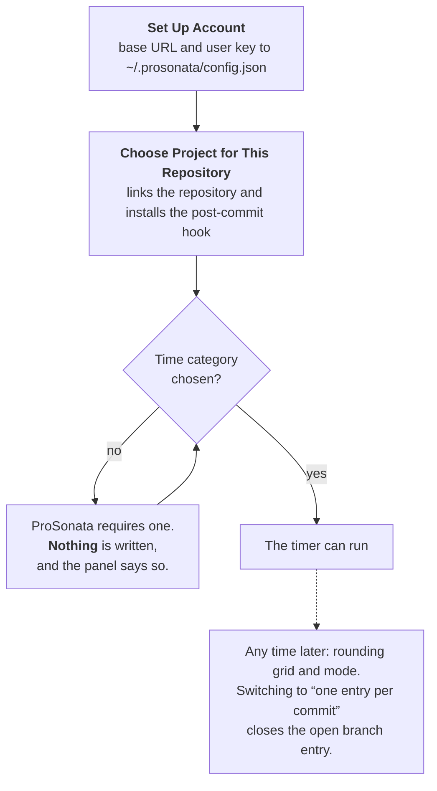
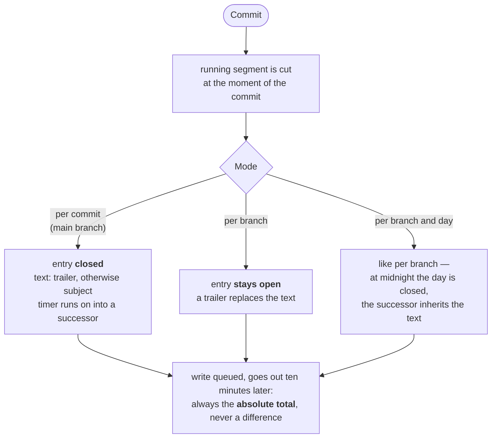
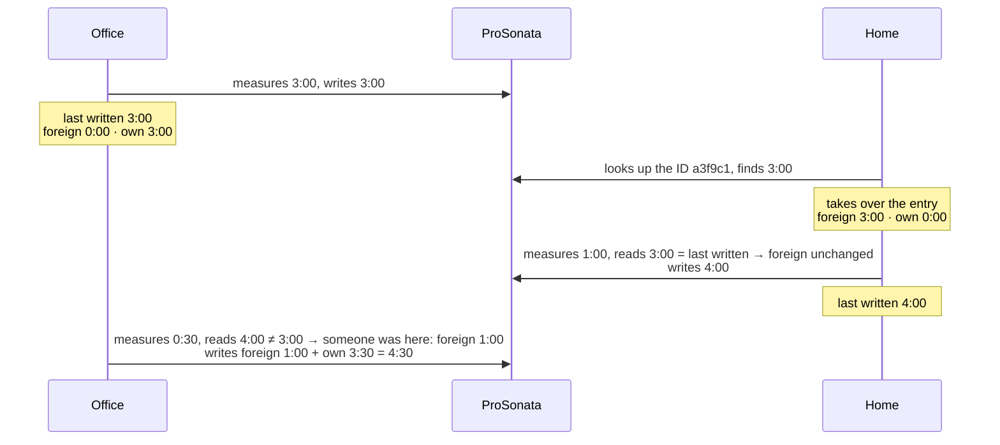
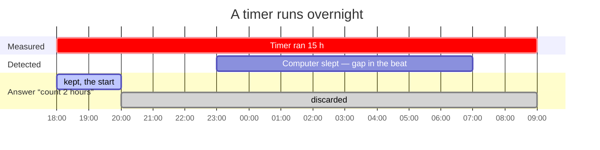

ProSonata Tools for Visual Studio Code
===========

This VS Code extension creates [ProSonata](https://www.prosonata.de) time entries straight from VS Code, bound to commits and branches, through the ProSonata API. Instead of starting a timer in ProSonata's web interface and typing the description by hand, you start the timer in VS Code, and the measured time becomes one time entry per branch — or, switchable, per branch and day or per commit — with a description taken from the commit.

The idea: a time entry represents a piece of work the client can be billed for. If you bill by deliverable, it doesn't matter whether the work took one day or several; if you bill by time, the two other modes are for you.

This is not an official ProSonata product. It is not in the Marketplace; you have to install it by hand.

## Language

The interface is English, with a German translation. The extension follows VS Code's display language. The CLI and the git hook take the language from `LC_ALL`, `LC_MESSAGES` or `LANG`, and otherwise from the language VS Code last used.

What goes into ProSonata stays German: an open entry is marked `[LAUFEND]`, and an entry without text is called `(in Arbeit)`. Both can be changed in `~/.prosonata/config.json` (`markerWord`, `placeholderText`).

## Installation

After installing or updating, reload the window (Developer: Reload Window), and the extension appears in every VS Code window. Updates have to be installed by hand.

### Ready-made package

To install or update, download the `.vsix` of the latest
[release](https://github.com/profitlich-ch/prosonata-vscode-tools/releases)
and install it:

#### Without a terminal

Command Palette → Extensions: Install from VSIX…

#### In a terminal

```sh
code --install-extension prosonata-vscode-tools-<version>.vsix
```

### From source

You need a Node environment. Building, packaging and installing happen in one
step — the result is the same `.vsix` as above:

```sh
npm install
npm run install-vsix
```

To update, do the same again after `git pull`.

## Configuration

Open **:Profitlich** in the Activity Bar and click ‹ProSonata: Set Up Account›. It asks for the ProSonata base URL and a user API key and writes both to `~/.prosonata/config.json` with mode 0600.

**Use a personal user key, not an app integration**, so the time entries are linked to your user.

Run the same command again later to **change the key or the base URL** — when the key expires, for instance. The base URL is already filled in, and leaving the key field empty keeps the current one. All other settings in `config.json` stay untouched; the gear in the panel's title bar opens the file itself. That is also where the defaults live that no dialog asks for: the rounding grid, the sending delay, the warning thresholds and sleep detection.

## Settings per repository

The order is fixed, and one step in it is a gate:



Click **ProSonata: Choose Project for This Repository** — it links the repository to a project and installs the `post-commit` hook. The project then shows its budget, such as “15.25 of 20 h”. It is fetched when the window opens and every time a closed time entry has reached ProSonata — not continuously.

Right after that the extension asks for the **time category**. ProSonata requires one on every time entry; as long as none is chosen, nothing is written. You can change it at any time through the *Category* row in the panel, and the change also applies to the entries that are still open.

The project can be corrected later as well. Since a change almost always fixes a mistake, all unfinished time entries of this repository move along — including those already in ProSonata, and the running measurement. Only what is closed, and whose closing has already reached ProSonata, stays behind; if such an entry is already invoiced there, a follow-up entry is created in the new project instead of a change.

You can also choose the rounding grid and the mode: one entry per branch, per branch and day, or per commit (see [How it works](#how-it-works)). The rounding grid applies to all open time entries the next time they are written. Switching to “one entry per commit”, on the other hand, closes the open branch entry and asks for its final text first.

The **rounding grid applies only to the time entry** that goes to ProSonata — never to the segments. Measuring and the log are exact to the second; rounding happens only when writing, and once per time entry — not for each segment. Rounding goes **up** to the next step: with a 15-minute grid, a measured 2:05 h is booked as 2:15 h. Because rounding happens per entry, **the rounding grows with the number of entries**: on `main` with three commits of twenty minutes each, that is three half hours, so 1:30 h instead of one hour. A branch entry collecting the same work is rounded once. This figure is shown everywhere as hours:minutes; ProSonata itself shows it as decimal hours (2.25), because that is how the API stores it.

If a repository chooses no grid of its own, the default from `~/.prosonata/config.json` (`"grid"`) applies. It is set to `exact` and can only be changed there — if you always bill by the quarter hour, set it once instead of in every repository.

Every command is also available on the [command line](#cli-commands).

## How it works

While you work in VS Code, times are stored locally on your computer as
**segments**. A **time entry** is what is stored in ProSonata. A time entry is
made of any number of segments.

Writing to ProSonata does not wait for the end: ten minutes after the timer
**starts**, the tool creates the time entry — still without text, under a
placeholder — and then updates it with the grown total on every further write.
A branch entry is therefore in ProSonata from the start and grows there.
Closing is just the last update.

| Where you work | What ProSonata gets | Meant for |
|---|---|---|
| On a branch | **One entry per branch**, growing over the branch's whole life | Billing by deliverable: one line for what was delivered |
| On a branch, switched | **One entry per branch and day** — cut at every midnight | Billing by time on branch work: one line per day with date and times |
| On the main branch | **One entry per commit** | Billing by time: maintenance, each commit one line |

The idea behind it: a branch is the piece of work a client pays for as a unit. Commits are intermediate steps the client doesn't need to see. Work on the main branch, however, is maintenance, and each commit is worth its own time entry. The mode can be switched per branch (“ProSonata: Choose Time Entry Mode”).

What a commit does depends on the mode — the segment is cut at the moment of the commit in every case:



The text of the time entry comes from the commit, from a trailer starting with `Prosonata:`:

```txt
fix: rounding error in the second discount tier

Prosonata: Discount calculation in the shop corrected
```

On the main branch, where each commit closes its own entry, the subject line
applies when there is no trailer. On a branch only the trailer counts; the one
written last in a commit wins, plain subject lines are ignored. An entry without
text appears in ProSonata as `[LAUFEND] (in Arbeit)` — the first trailer replaces
the placeholder. It is needed so a second computer finds the entry before the
first commit; the search goes by ID, and the ID only exists after the first
write. On a branch, the sidebar reminds you with the row **No text** that the
invoice line is still missing. An entry without text cannot be closed: it would
end up nameless with the client for good.

What the tool needs to know about a time entry is kept in ProSonata's
`apiComments` field, which appears on no invoice: the ID of the branch, so other
computers find the entry again, whether it is open, and since when a timer has
been running. The invoice line only carries a hint for people:

| State | Text in ProSonata |
|---|---|
| open | `[LAUFEND] Text` |
| closed | `Text` |

The `[LAUFEND]` stands out when invoicing, should a closing ever be missing.
Removing it by hand in ProSonata does no harm: the field carries the state.
Entries from before the field still carry the ID in the text, such as
`[LAUFEND:a3f9c1] Text`; they are still recognised and converted on the next
write.

The **Start** and **End** fields hold the span of the working day — the start of
the first and the end of the latest segment. If an entry spans several days,
both stay empty: a span only means something for a single day.

## On several computers

The ID of a branch comes from the first commit of the repository and the branch
name — the same in every clone. The second computer therefore finds the time
entry again and **adds to** it instead of creating a second one. This assumes
the two don't measure at the same time.

Each computer remembers the **foreign share** and writes `foreign + own`. It
knows the foreign share from the difference between what it last wrote itself
and what is in ProSonata.



The value written depends only on the computer's own state, never on what it
just read — so a repeated write never doubles anything.

Two **people**, on the other hand, don't get in each other's way: times belong
to users in ProSonata, and each keeps their own entry per branch.

If a timer is currently running on the same branch on another computer, you are
told when you start — with the day it was started. If that was before
yesterday, it no longer says “running since” but “stopping was probably
forgotten there”. The extension can't do more than tell you: a timer on a closed
laptop can't be stopped from here.

If one computer closes the entry while time has accumulated on the other, the
other one asks: **add to the closed entry** or **create a new one**. Nothing is
written until you answer, and the closed entry is never touched without asking.

## When a timer is forgotten

If a segment runs for hours on end, the extension asks **how much of it
counts** — all of it, a duration of your own, or nothing. It doesn't guess: a
timer that ran overnight measured wall-clock time, and only you know how much
of it was work. If you answer “two hours”, those are the **first** two — the
work was at the start, the stopping was forgotten.

If the computer **slept** in between, the extension knows exactly: timers don't
fire while a machine is suspended, and a beat that comes back hours later proves
that nothing ran on this machine. The panel then shows a row with the measured
duration — deduct or keep. After deducting, the timer continues from the moment
of waking up.



Without waiting for that question, a running segment can be **discarded
entirely** at any time — the case “committed, forgot to stop, didn't work
afterwards”. The option sits at the top of the adjustment dialog and names the
amount. Nothing is booked, the timer stops, and the log keeps the discarded
duration as `trimmed from …`.

You can **turn the time forward and back** with the pencil icon on the timer
row or with “ProSonata: Adjust Time”. Type either a duration or a clock time:

| Input | Meaning |
|---|---|
| `25` | offers `+25` and `−25` |
| `-25`, `+1:30` | exactly this direction |
| `from 9:40` | I've been working since 9:40 — the start of the running segment moves there |
| `until 9:40` | I stopped at 9:40 — time is booked up to then and the timer stops |

The German `ab 9:40` and `bis 9:40` work as well.

**Clock times need a running timer.** They change the running segment; when
the timer is stopped, there is none they could refer to. Then add time as a
duration — `+20` books twenty minutes without claiming when they happened. The
log therefore shows such an adjustment without a start time.

Every option shows beforehand what it does: `7:13:09 → 7:08:09`. No adjustment
reaches further back than the **end of the last segment** — a closed segment
says precisely that everything up to then was recorded correctly. If an
adjustment is cut short for that reason, the same option says what is possible
instead and why: “only from 14:25 → that's as far as the last segment reaches”.
An entry never drops below zero either.

Closing the last VS Code window pauses the timer. Turn this off with
`"pauseOnWindowClose": false` in `~/.prosonata/config.json`.

The status bar shows what the branch has collected **in total** — the figure
that goes on the invoice. The running segment is in the tooltip, together with
the branch and the sending status. The panel shows both figures side by side,
the running segment first: `0:42:13 · 3:48:02`.

## Follow-up work after a commit

On `main`, each commit closes its time entry. If you keep working afterwards —
the last check, the deployment, the phone call — and don't commit again, you
have measured time that belongs to the commit you just made. Otherwise it would
only go out with the **next** commit, under that commit's text.

For this the sidebar shows **Not booked** as soon as such time is there. It is
always attached to the last closed entry of this branch, as a plain total — the
text and date there stay as they are. You confirm first, with the figures:

    5 minutes to “Kirby update, home page link colour” (2026-08-02)
    2:00 h becomes 2:15 h

The second line is the reason for asking: the rounding grid rounds **up**, so a
quarter-hour grid turns five minutes into a quarter of an hour. An entry that
is already **invoiced** is refused — that can only be done in ProSonata itself.
If the open entry is already in ProSonata, it disappears when attached: its
time has moved. Only if another computer measured into it does it stay, and
attaching is refused.

## Browsing time entries

The list icon in the title bar of the ProSonata panel fetches the time entries
of the current repository from ProSonata into a list where several can be
selected; in the Command Palette it is called “ProSonata: Browse Time Entries”.
It offers three actions:

- **Change text and hours** — the pencil icon on a row. Type hours as `h:mm` or
  as a decimal number; the new total is written, rounded to the grid.
- **Merge** — select several; one entry stays, the others are deleted once the
  total is safely on the remaining one. The suggested hours come from the
  measured segments, rounded to the grid **once**: merging afterwards says the
  work was done in one go, and one go is rounded once, not three times. If the
  segments don't cover the entries — because another computer measured, for
  instance — the total from ProSonata is shown, with a note explaining why.
- **Delete** — after confirming with the figures.

**Invoiced entries stay** in all three actions: they belong to the invoice. The
segment log is not adjusted; it remains the archive of the measurement, while
the billing is what gets corrected.

## The log

The clock icon next to it opens all measured segments as a rendered preview,
grouped by day, with a branch picker in front. It can't be edited: the log is
an archive, and what is billed is in the time entry. Corrections therefore go
through time adjustment, not the text.

When a time entry is closed, it gets a row of its own — without times, with its
total and the note **Time entry**. Everything above belongs to it; that way you
see which segments went into which invoice line without the text being repeated
on every row. When you show a single branch, the branch column is left out.

The branch list comes from the log in `~/.prosonata/segments.jsonl`, not from
git — **deleted branches keep their hours**. The log is never trimmed; it is
the only thing that tells how much was worked on which *day*. A time entry only
carries a total and the date of its last write.

What is recorded is what was measured on this computer. What happened on
another one is in ProSonata, but not here.


## CLI commands

```sh
prosonata init                    set up account and this repository, install the hook
prosonata start                   start or resume this branch's timer
prosonata pause [h:mm|minutes]    pause the timer; with a duration, only that is booked
prosonata status                  what is running, what is open, what is waiting
prosonata send                    send everything that is due now

prosonata project                 choose this repository's project
prosonata category                choose this project's time category
prosonata grid [exact|5|15|30]    round to this many minutes
prosonata mode [branch|day|commit] one entry per branch, per branch and day, or per commit
prosonata close [no] [text]       close the open time entry and send it; with a number, another branch's
prosonata text <text>             change the text of the open time entry
prosonata discard                 discard the running segment without booking it
prosonata attach                  attach time to the entry of the last commit
prosonata resume [add|new]        resolve an entry closed elsewhere
prosonata rejected [no retry|move|drop]
                                  rejected entries: send again, move to another project, discard
prosonata resting [no close|keep|drop]
                                  entries dormant for weeks: close, keep, discard
prosonata tidy                    remove empty leftovers of deleted branches in all repositories
prosonata log [branch|all|?]      measured segments, this branch's if none is given
prosonata adjust <value>          adjust time: ±25, ±1:30, "from 9:40", "until 9:40"
```

A command that takes an argument asks for it when it is left out — with the
argument it runs without asking, which also makes it fit for scripts. The
earlier German argument values (`exakt`, `tag`, `neu`, `alle`, `ab`, `bis`)
still work.

## What the extension doesn't do

- **No activity detection.** Activity in the file system is not the same as
  billable time. The tool warns; it never books on its own.
- **No automatic start** on checkout, merge or when the editor opens.
- **No remote stop.** If a timer is running on another computer, it warns — it
  can't stop it, let alone book the time for you.
- **No storage in the repository.** It would sit in the client's repository and
  show them the effort per commit. All segments stay locally on the computer.
- **Nothing is sent at commit time.** A write goes out once it is older than
  ten minutes, so a commit that is taken back never reaches ProSonata at all.

## Development

### Trying out a change

Nothing gets installed for this. **F5** opens a second VS Code window in which
the extension runs straight from this working directory. There are two launch
configurations:

- **Extension in the real account** — with your `~/.prosonata` and your projects.
  What you do there lands in ProSonata.
- **Extension in the sandbox** — with its own state directory and a throwaway
  repository under `.sandbox` that already has a project, category and hook.
  The base URL points nowhere, so nothing is sent; all writes collect visibly
  in the queue.

The sandbox has to be created first — the command rebuilds it every time:

```sh
npm run sandbox                   # offline
npm run sandbox -- --live 166 70  # real account, project 166, category 70
```

The two dashes before `--live` are required: without them npm swallows the
argument, and the sandbox stays offline as if nothing had been said.

### Checking and building

```sh
npm run check    # types, tests, build in one go
npm run watch    # rebuilds on every change
```

`src/core` contains all the rules and never imports `vscode` — which is why the
hook can use it. `src/cli` and `src/extension` are two frontends over the same
core: a commit from the terminal behaves exactly like one from the editor.

Visible texts go through `t()` from `src/core/l10n.ts`, in English; the German
translation is in `l10n/bundle.l10n.de.json`, the command titles in
`package.nls.json` and `package.nls.de.json`. A test fails when a text has no
German translation.

The full reasoning, including the rejected alternatives and why, is in
[KONZEPT.md](KONZEPT.md) (German). The API behaviour the tool relies on was
measured against a live account; the requests are in [bruno/](bruno/).

## License

MIT — see [LICENSE](LICENSE).
